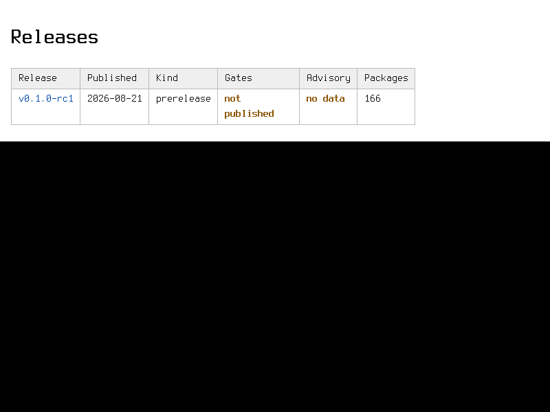
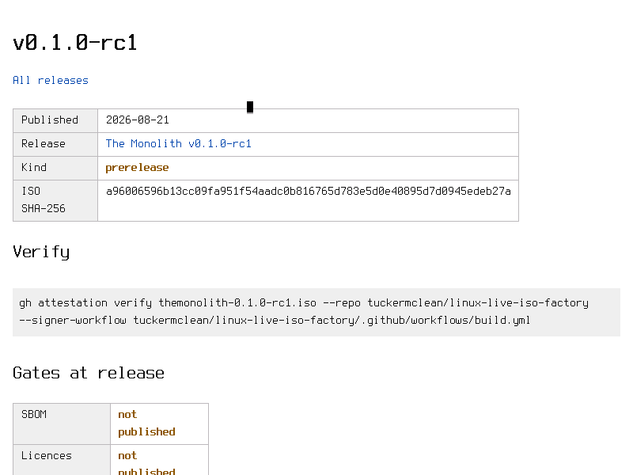

# dashboard-stele: the release dashboard in Stele on a booted Monolith ISO

P04-AC-9: the index and one release page read in Stele on a booted Monolith ISO. This file records
the ISO, how the pages were loaded and a screenshot of each page.

## Outcome

**Both pages read in Stele.** On the booted `v0.1.0-rc1` ISO, `stele` fetched the index and the
`v0.1.0-rc1` release page over HTTP and rendered each on the framebuffer. The screenshots show the
release list and the gate marks as words (`not published`, `no data`), not only as colours.

| | |
|---|---|
| Date | 2026-11-14 (UTC) |
| ISO | `themonolith-0.1.0-rc1.iso` from the `v0.1.0-rc1` release of `tuckermclean/linux-live-iso-factory`, sha256 `a96006596b13cc09fa951f54aadc0b816765d783e5d0e40895d7d0945edeb27a` (the Makefile's `RC1_SHA256`) |
| Kernel | `6.12.80-i486-monolith` (read from the ISO's `/boot/vmlinuz`) |
| Browser | `/usr/bin/stele` on the ISO, `--headless --render-fb` (paints `/dev/fb0`, as the `stele-acid2` boot mode does) and `--headless --dump-text` |
| Generator | `scripts/dashboard.py` and `scripts/dashboard.css` at `6c6c094` |
| Machine | QEMU `qemu-system-i386` in the toolbox, `-cpu 486 -m 256 -vga std`, BIOS, ISOLINUX label `serial vga=788`, QEMU's default e1000 NIC on user-mode networking |
| Where the pages came from | The site tree served over plain HTTP from the QEMU host at `10.0.2.2:8000`. The OD-1 URL was not used: `monolith.technomantics.com` does not resolve yet, because the Pages site and its DNS are set up after the advisory feed merges. |

## How the pages were made and loaded

1. The site was generated on the host from live GitHub data. This repository has no release yet, so
   the index lists only rc1. rc1's SBOM came from its release and was checked against the Makefile's
   `RC1_SBOM_SHA256`. The feed had published no status file, so the advisory status reads `no data`:
   ```sh
   mkdir -p feed/site/status feed/data/v0.1.0-rc1
   curl -fsSL -o feed/data/v0.1.0-rc1/bom.cdx.json "$RC1_SBOM_URL"   # sha256 3cfc322a…5887
   GITHUB_REPOSITORY=tuckermclean/themonolith RC1_TAG=v0.1.0-rc1 \
     python3 -I scripts/dashboard.py --site feed/site --data feed/data --result feed/result   # exit 0, result ok
   ```
   This wrote `index.html` (585 bytes), `v0.1.0-rc1/index.html` (18,129 bytes; 166 packages) and
   `style.css`.
2. In one toolbox container, `python3 -m http.server 8000 --bind 127.0.0.1` served `feed/site`. The
   ISO was then booted with the `stele-acid2` rig of `scripts/boot-test.py` (`build_gui_cmd`, QMP
   screendump), with a runner that drives these guest commands instead of rendering Acid2:
   ```sh
   ip -4 addr show eth0                                    # DHCP lease from QEMU's user-mode network
   stele --headless --dump-text http://10.0.2.2:8000/
   clear; stele --headless --render-fb http://10.0.2.2:8000/              # then a QMP screendump
   stele --headless --dump-text http://10.0.2.2:8000/v0.1.0-rc1/
   clear; stele --headless --render-fb http://10.0.2.2:8000/v0.1.0-rc1/   # then a QMP screendump
   ```
3. Every check passed, and the run ended `RESULT: PASS`. eth0 had an IPv4 address, each `stele` exited
   0, and the two screendumps were 33.9% and 98.6% non-black. The HTTP log shows each page fetched
   with its stylesheet. From `v0.1.0-rc1/`, the relative `../style.css` resolved to `/style.css`:
   ```text
   "GET / HTTP/1.1" 200
   "GET /style.css HTTP/1.1" 200
   "GET /v0.1.0-rc1/ HTTP/1.1" 200
   "GET /style.css HTTP/1.1" 200
   ```

## Screenshots

The framebuffer is 800×600, so the release page's screenshot shows its top: the release facts, the
verify command and the first gates. Its text dump, below, shows the rest.

**Index** (`dashboard-stele/index.png`, sha256 `e1b25b00…1e38`):



**Release page** (`dashboard-stele/release.png`, sha256 `592ca7eb…8988`):



## Text dumps

The `--dump-text` output, with blank lines removed. Index:

```text
  Releases
  ┌Release─────┌Published──┌Kind────────┌Gates────────┌─Advisory─┌Packages──┐
  │            │           │            │             ││         │          │
  ┌v0.1.0-rc1──┌2026-08-21─┌prerelease──┌not──────────┌─no data──┌166───────┐
  │            │           │            │             ││         │          │
  │            │           │            │published    ││         │          │
  └────────────└───────────└────────────└─────────────└──────────└──────────┘
```

The release page, up to the package tables (550 lines in all: the licence summary, then one row per
package with its version and licence):

```text
  v0.1.0-rc1
  All releases
  ┌Published──┌2026-08-21───────────────────────────────────────────────────────
  ┌───────────┌─────────────────────────────────────────────────────────────────
  │Release    │The Monolith v0.1.0-rc1
  ┌───────────┌─────────────────────────────────────────────────────────────────
  │Kind       │prerelease
  ┌ISO────────┌a96006596b13cc09fa951f54aadc0b816765d783e5d0e40895d7d0945edeb27a─
  │           │
  │SHA-256    │
  └───────────└─────────────────────────────────────────────────────────────────
  Verify
   gh attestation verify themonolith-0.1.0-rc1.iso --repo
   tuckermclean/linux-live-iso-factory --signer-workflow
   tuckermclean/linux-live-iso-factory/.github/workflows/build.yml
  Gates at release
  ┌SBOM──────────┌─not───────────┐
  │              ││              │
  │              ││published     │
  ┌──────────────┌───────────────┐
  │Licences      ││not           │
  │              ││published     │
  └──────────────└───────────────┘
  ┌CVEs──────────┌─not───────────┐
  │              ││published     │
  └──────────────└───────────────┘
  ┌Unowned───────┌─not───────────┐
  │              ││              │
  │files         ││published     │
  ┌Overall───────┌─not───────────┐
  │              ││              │
  │              ││published     │
  └──────────────└───────────────┘
  This release published no gate summary.
  Advisory status
  ┌Status──┌no──────┐
  │        │data    │
  └────────└────────┘
  Assets
       * bom.cdx.json
       * SHA256SUMS
       * themonolith-0.1.0-rc1.iso
  Packages
  Licences
  ┌Licence─────────────────────────────────────────────────────────┌─Packages─┐
```

## What it does not show

- Stele used the light theme. This run cannot show the dark theme under `prefers-color-scheme: dark`.
  The `.mark` borders were not drawn. The marks' words and their bold and colour were.
- The pages came from the host at `10.0.2.2`, not from the OD-1 URL. Fetching them from the published
  site is P04-AC-8's run, after the merge.
- rc1 has no `attestation-summary.json` and no status file yet. The `pass`, `fail`, `unverified`,
  `clean` and `revoked` marks are covered by `scripts/tests/dashboard.test.sh`, not by this run.
